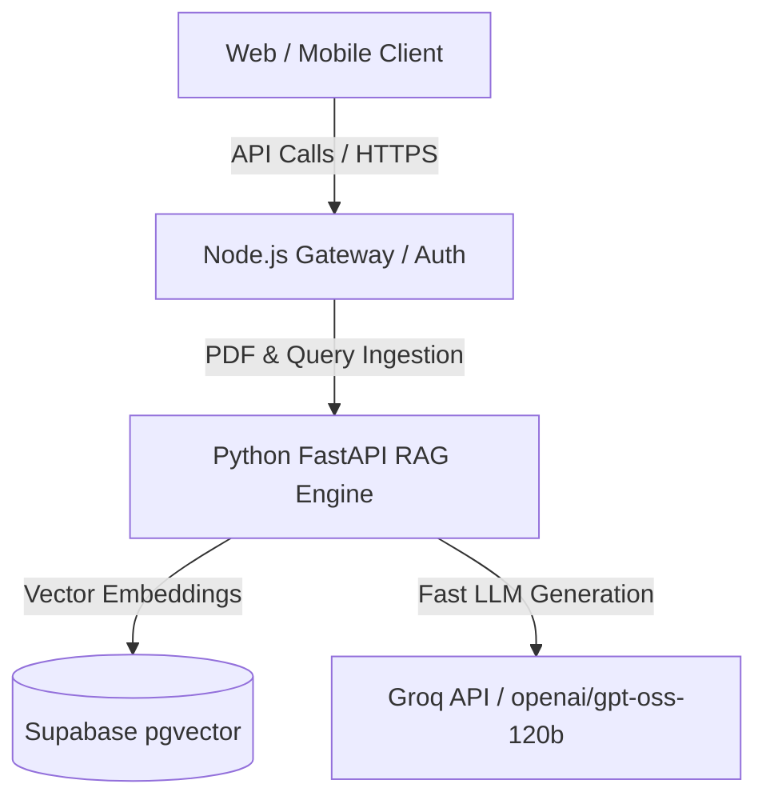

# Project Eklavya - Technical Design Document

## System Architecture

## PDF Ingestion & Retrieval Data Flow
1. **Document Upload:** Textbook PDF uploaded through `/api/upload`.
2. **Text Extraction:** Processed via PyPDF into raw text streams.
3. **Semantic Chunking:** Partitioned into 800-word blocks with a 150-word overlap.
4. **Vector Embedding:** Transformed into 384-dimensional dense vectors using `paraphrase-multilingual-MiniLM-L12-v2`.
5. **Similarity Search:** Query matched against Supabase using Cosine Distance (`<=>`).
6. **Bilingual Synthesis:** Context fed into Groq LLM to yield Hinglish explanations with cognitive active-recall checkpoints.